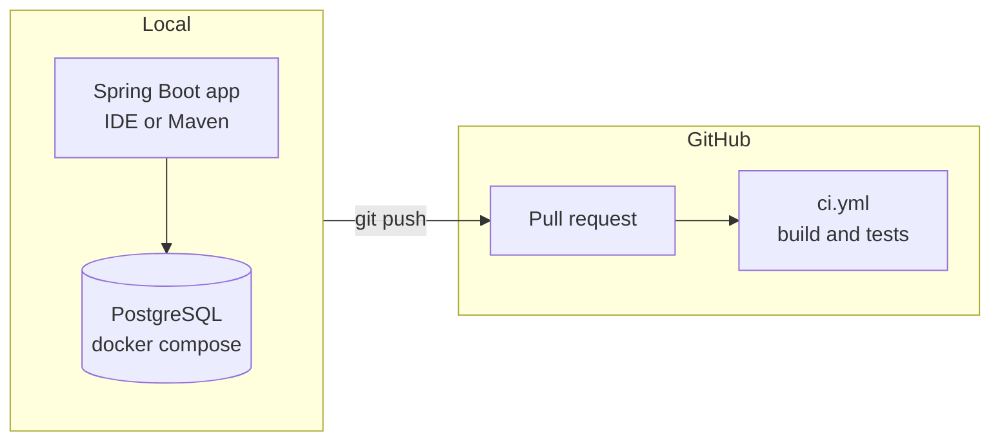
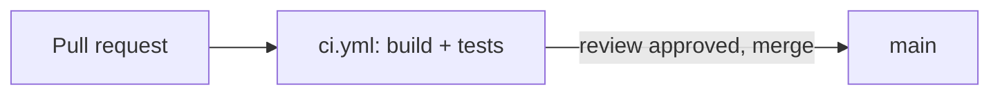

# bonify-api

[](https://github.com/<github-owner>/bonify-api/actions/workflows/ci.yml)


A REST API for a simplified retail bank, built with **Spring Boot** and with a **CI** pipeline that builds and tests every pull request.

Customers register, open accounts, deposit and withdraw money, and send transfers that are **atomic, idempotent and safe under concurrency**. Administrators manage customers and can block accounts.

Final project of a Java Spring Boot course.

- **Functional analysis:** [functional-analysis.md](functional-analysis.md)

---

## Table of contents

- [Features](#features)
- [Tech stack](#tech-stack)
- [Architecture](#architecture)
- [Getting started](#getting-started)
- [Configuration](#configuration)
- [Using the API](#using-the-api)
- [Testing](#testing)
- [CI pipeline](#ci-pipeline)
- [Design decisions](#design-decisions)
- [Project structure](#project-structure)
- [Authors](#authors)

---

## Features

**Customers**
- Registration with phone number and Italian tax code (*codice fiscale*, format check), login with a short-lived JWT access token (5 minutes) and a refresh token rotated on every use, one active session per customer
- View and update personal data (name, phone)
- Change password (current password required)

**Accounts**
- Open EUR current accounts with a generated IBAN
- Deposit and withdraw, with no negative balances
- Paginated transaction history with date filter

**Transfers**
- Atomic transfers between accounts: both sides succeed or nothing changes
- Idempotent requests through the `Idempotency-Key` header: a retried request never moves money twice
- Concurrency-safe: 100 parallel transfers keep balances correct, verified by an automated test

**Administration**
- List and edit customers
- Block and unblock accounts

**Operations**
- OpenAPI documentation with Swagger UI

---

## Tech stack

| Area | Technology |
|---|---|
| Language and build | Java 25, Maven |
| Framework | Spring Boot 4 (Web MVC, Data JPA, Validation, Security, OAuth2 Resource Server) |
| Database | PostgreSQL 16, schema generated by Hibernate |
| Security | Spring Security, JWT, BCrypt |
| API docs | springdoc-openapi (Swagger UI) |
| Testing | JUnit 5, Mockito, Spring MockMvc |
| Containers | Docker Compose (PostgreSQL only) |
| CI | GitHub Actions |

---

## Architecture



A single Spring Boot application, organised by feature (`auth`, `customer`, `account`, `transaction`, `transfer`). Swagger UI, served by the app, is the client.

---

## Getting started

### Prerequisites

- Docker and Docker Compose, for PostgreSQL
- Java 25, Maven and Git

### Run locally

The project is not deployed anywhere: Docker Compose runs only the database, the app runs from your IDE or with Maven.

```bash
git clone https://github.com/<github-owner>/bonify-api.git
cd bonify-api
cp .env.example .env        # then edit the values
docker compose up -d        # PostgreSQL
mvn spring-boot:run         # the app, or run BonifyApplication from your IDE
```

| Service | URL |
|---|---|
| API | http://localhost:8080 |
| Swagger UI | http://localhost:8080/swagger-ui.html |
| PostgreSQL | localhost:`DB_PORT` (credentials from `.env`) |

There is no demo data yet: register a customer from Swagger UI to start.

---

## Configuration

All secrets come from environment variables. Nothing sensitive is committed to the repository. The app reads them from the environment or from the `.env` file in the project root (loaded by `EnvConfig`); Docker Compose uses the same file.

| Variable | Description | Example |
|---|---|---|
| `DB_HOST` | PostgreSQL host | `localhost` |
| `DB_PORT` | PostgreSQL port, also the port published by Docker Compose | `5432` |
| `DB_NAME` | Database name | `bonify-db` |
| `DB_USER` | Database user | `bonify` |
| `DB_PASSWORD` | Database password | — |
| `JWT_SECRET` | Secret used to sign tokens, at least 32 bytes | — |

The `POSTGRES_*` values are applied only when the Docker volume is created. If you change `DB_NAME`, `DB_USER` or `DB_PASSWORD` later, recreate the volume (`docker compose down -v`, which deletes the data) or change them inside PostgreSQL.

Token durations are set in `application.properties`:

| Property | Description | Default |
|---|---|---|
| `bonify.jwt.expiration` | Access token validity | `5m` |
| `bonify.jwt.refresh-expiration` | Refresh token validity, restarted on every refresh | `7d` |

There are no Spring profiles: the same configuration is used locally and in CI.

---

## Using the API

The easiest way is **Swagger UI**: log in, click **Authorize**, paste the token and try every endpoint.

### Endpoints

| Method | Path | Description | Access |
|---|---|---|---|
| POST | `/api/v1/auth/register` | Register a customer | Public |
| POST | `/api/v1/auth/login` | Get an access token and a refresh token | Public |
| POST | `/api/v1/auth/refresh` | Swap the refresh token for a new pair (rotation) | Public |
| POST | `/api/v1/auth/logout` | End the session | Public |
| GET | `/api/v1/customers/me` | Own profile | Customer, Admin |
| PATCH | `/api/v1/customers/me` | Update own personal data | Customer, Admin |
| PUT | `/api/v1/customers/me/password` | Change own password | Customer, Admin |
| GET | `/api/v1/customers` | List customers | Admin |
| PATCH | `/api/v1/customers/{id}` | Update a customer | Admin |
| POST | `/api/v1/accounts` | Open an account | Customer |
| GET | `/api/v1/accounts` | Own accounts | Customer |
| GET | `/api/v1/accounts/{iban}` | Account detail and balance | Owner, Admin |
| POST | `/api/v1/accounts/{iban}/deposit` | Deposit | Owner |
| POST | `/api/v1/accounts/{iban}/withdraw` | Withdraw | Owner |
| GET | `/api/v1/accounts/{iban}/transactions` | Transaction history | Owner, Admin |
| PATCH | `/api/v1/accounts/{iban}/status` | Block or unblock an account | Admin |
| POST | `/api/v1/transfers` | Send a transfer | Source account owner |
| GET | `/api/v1/transfers/{id}` | Transfer detail | Sender, receiver, Admin |

### Example with curl

```bash
# 1. Register and log in
curl -X POST http://localhost:8080/api/v1/auth/register \
  -H "Content-Type: application/json" \
  -d '{"firstName":"Anna","lastName":"Rossi","email":"anna@example.com","phoneNumber":"+393401234567","taxCode":"RSSNNA90A41H501N","password":"secret123"}'

LOGIN=$(curl -s -X POST http://localhost:8080/api/v1/auth/login \
  -H "Content-Type: application/json" \
  -d '{"email":"anna@example.com","password":"secret123"}')
TOKEN=$(echo "$LOGIN" | jq -r .accessToken)            # valid for 5 minutes
REFRESH=$(echo "$LOGIN" | jq -r .refreshToken)

# When the access token expires (401), swap the refresh token for a new pair.
# The old refresh token stops working: always keep the latest one.
curl -s -X POST http://localhost:8080/api/v1/auth/refresh \
  -H "Content-Type: application/json" \
  -d "{\"refreshToken\":\"$REFRESH\"}"

# 2. Open an account and deposit 500 EUR
IBAN=$(curl -s -X POST http://localhost:8080/api/v1/accounts \
  -H "Authorization: Bearer $TOKEN" | jq -r .iban)

curl -X POST http://localhost:8080/api/v1/accounts/$IBAN/deposit \
  -H "Authorization: Bearer $TOKEN" -H "Content-Type: application/json" \
  -d '{"amount": 500.00}'

# 3. Send a transfer (retrying with the same key does not move money twice)
curl -X POST http://localhost:8080/api/v1/transfers \
  -H "Authorization: Bearer $TOKEN" -H "Content-Type: application/json" \
  -H "Idempotency-Key: $(uuidgen)" \
  -d "{\"fromIban\":\"$IBAN\",\"toIban\":\"<destination IBAN>\",\"amount\":150.00,\"description\":\"Rent\"}"
```

### Errors

Errors follow the RFC 7807 `ProblemDetail` format, with a stable `code` field:

```json
{
  "title": "Insufficient funds",
  "status": 422,
  "detail": "Account IT60X0542811101000000000001 has 100.00 EUR, 150.00 EUR requested",
  "instance": "/api/v1/transfers",
  "code": "INSUFFICIENT_FUNDS"
}
```

| Status | When |
|---|---|
| 400 | Invalid input (including tax code and phone format), same source and destination, wrong current password |
| 401 | Missing, invalid or expired access token; wrong credentials; invalid, expired or reused refresh token |
| 403 | Not your account or not an admin |
| 404 | Customer, account or transfer not found |
| 409 | Email or tax code already used, idempotency key reused with a different body |
| 422 | Insufficient funds, blocked account |

---

## Testing

```bash
docker compose up -d        # PostgreSQL, needed by BonifyApplicationTests
mvn verify
```

| Type | What it covers |
|---|---|
| Unit | Services and business rules, with Mockito |
| Web layer | Controllers, validation, security rules and error format, with MockMvc and mocked repositories |
| Context | `BonifyApplicationTests` starts the whole application against the PostgreSQL configured in `.env` |

Planned: the concurrency test of NFR-03 (100 parallel transfers between the same accounts: no deadlock, no negative balance, total money unchanged).

---

## CI pipeline



- **`ci.yml`** runs on every pull request to `main` and on every push to `main`: starts a PostgreSQL 16 service, sets up Java with the Maven cache and runs `mvn verify`.
- **Branch protection:** `main` accepts only pull requests with one approval and a green CI.

There is no CD pipeline: the project is not deployed anywhere.

---

## Design decisions

**Money as `BigDecimal`.** Amounts are `BigDecimal` in Java and `NUMERIC(19,2)` in PostgreSQL. Floating point types are never used for money.

**Pessimistic locking with ordered locks.** A transfer locks both accounts with `SELECT ... FOR UPDATE` inside one transaction. Accounts are always locked in ascending id order, so two opposite transfers (A→B and B→A) cannot deadlock. Optimistic locking with retries was considered, but under high contention on the same accounts it causes many retries and more complex code.

**Idempotency keys.** Clients send a unique `Idempotency-Key` with each transfer. The key is stored with a hash of the request: the same request sent again returns the original result, while the same key with a different body is rejected with `409`. This protects customers from double payments after timeouts or retries.

**Ledger.** Every balance change writes a line in `account_transaction` with the resulting balance, in the same transaction. The balance can always be rebuilt from the ledger. A database `CHECK (balance >= 0)` is the last line of defence.

**JWT subject is the customer id.** Tokens identify the customer by id, not email, so a token stays valid when the customer changes their email.

**Short-lived access token, rotating refresh token.** The access token (JWT) lasts 5 minutes and is validated without touching the database. The refresh token is an opaque random value stored only as a SHA-256 hash in `refresh_tokens`; every refresh replaces it. A refresh token presented twice means it was copied, so the whole session is revoked. Each customer has one active session: a new login ends the previous one.

**Schema generated by Hibernate.** The schema comes from the JPA entities (`ddl-auto=update`); there is no migration tool. Hibernate adds new tables and columns but never drops them.

---

## Project structure

```text
.
├── .github/workflows/ci.yml
├── src/main/java/com/bonifybank/bonify/
│   ├── config/                   # security, JWT, .env loading, API versioning, scheduling
│   ├── exception/                # business exceptions, global handler (RFC 7807)
│   └── modules/
│       ├── auth/                 # registration, login, JWT, refresh tokens
│       ├── customer/             # profile, password, admin customer management
│       ├── account/              # accounts, deposits, withdrawals, blocking
│       ├── transaction/          # ledger and history
│       └── transfer/             # transfers, idempotency, locking
├── src/main/resources/
│   └── application.properties
├── src/test/java/com/bonifybank/bonify/
├── functional-analysis.md
├── DAILYTASKS.md
├── docker-compose.yml
├── .env.example
└── pom.xml
```

---

## Authors

- **<Name Surname>** — [GitHub](https://github.com/<username>) · [LinkedIn](https://www.linkedin.com/in/<username>)
- **<Name Surname>** — [GitHub](https://github.com/<username>) · [LinkedIn](https://www.linkedin.com/in/<username>)
- **<Name Surname>** — [GitHub](https://github.com/<username>) · [LinkedIn](https://www.linkedin.com/in/<username>)
