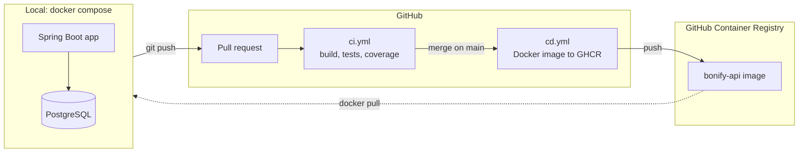
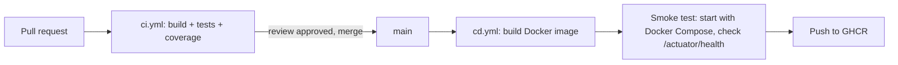

# bonify-api

[](https://github.com/<github-owner>/bonify-api/actions/workflows/ci.yml)
[](https://github.com/<github-owner>/bonify-api/actions/workflows/cd.yml)


A REST API for a simplified retail bank, built with **Spring Boot** and delivered with a full **DevOps** pipeline: automated tests on every pull request and Docker images published automatically on every merge.

Customers register, open accounts, deposit and withdraw money, and send transfers that are **atomic, idempotent and safe under concurrency**. Administrators manage customers and can block accounts.

Final project of a Java Spring Boot course.

- **Functional analysis:** [docs/functional-analysis.md](docs/functional-analysis.md)

---

## Table of contents

- [Features](#features)
- [Tech stack](#tech-stack)
- [Architecture](#architecture)
- [Getting started](#getting-started)
- [Configuration](#configuration)
- [Using the API](#using-the-api)
- [Testing](#testing)
- [CI/CD pipeline](#cicd-pipeline)
- [Design decisions](#design-decisions)
- [Project structure](#project-structure)
- [Authors](#authors)

---

## Features

**Customers**
- Registration with Italian tax code (*codice fiscale*) validation, and login with JWT
- View and update personal data (name, email, phone)
- Change password (current password required)

**Accounts**
- Open EUR current accounts with a generated IBAN
- Deposit and withdraw, with no negative balances
- Paginated transaction history with date filter

**Transfers**
- Atomic transfers between accounts: both sides succeed or nothing changes
- Idempotent requests through the `Idempotency-Key` header: a retried request never moves money twice
- Concurrency-safe: 100 parallel transfers keep balances correct, verified by an automated test

**Administration**
- List and edit customers
- Block and unblock accounts

**Operations**
- OpenAPI documentation with Swagger UI
- Health check endpoint
- Build info endpoint showing the running version and commit

---

## Tech stack

| Area | Technology |
|---|---|
| Language and build | Java 21, Maven |
| Framework | Spring Boot (Web, Data JPA, Validation, Security, Actuator) |
| Database | PostgreSQL, Flyway migrations |
| Security | Spring Security, JWT, BCrypt |
| API docs | springdoc-openapi (Swagger UI) |
| Testing | JUnit 5, Mockito, Testcontainers, JaCoCo |
| Containers | Docker (multi-stage build), Docker Compose |
| CI/CD | GitHub Actions, GitHub Container Registry |

---

## Architecture



A single Spring Boot application, organised by feature (`auth`, `customer`, `account`, `transaction`, `transfer`). Swagger UI, served by the app, is the client.

---

## Getting started

### Prerequisites

- Docker and Docker Compose
- Java 21 and Git, only if you want to run the app outside Docker

### Run everything with Docker

```bash
git clone https://github.com/<github-owner>/bonify-api.git
cd bonify-api
cp .env.example .env        # then edit the values
docker compose up --build
```

| Service | URL |
|---|---|
| API | http://localhost:8080 |
| Swagger UI | http://localhost:8080/swagger-ui.html |
| Health | http://localhost:8080/actuator/health |
| PostgreSQL | localhost:5432 (credentials from `.env`) |

The `dev` profile loads demo data: an admin user and two customers with accounts. Their credentials are listed in `.env.example`.

### Run the app from your IDE or Maven

Start only the database, then the app:

```bash
docker compose up -d postgres
./mvnw spring-boot:run -Dspring-boot.run.profiles=dev
```

On Windows use `mvnw.cmd` instead of `./mvnw`.

---

## Configuration

All secrets come from environment variables. Nothing sensitive is committed to the repository.

| Variable | Description | Example |
|---|---|---|
| `SPRING_PROFILES_ACTIVE` | `dev` or `test` | `dev` |
| `DB_URL` | JDBC URL of PostgreSQL | `jdbc:postgresql://localhost:5432/bonify` |
| `DB_USER` | Database user | `bonify` |
| `DB_PASSWORD` | Database password | — |
| `JWT_SECRET` | Secret used to sign tokens, at least 32 characters | — |
| `JWT_EXPIRATION_MINUTES` | Token validity | `60` |
| `ADMIN_EMAIL`, `ADMIN_PASSWORD` | First admin, created at startup | — |

| Profile | Used for | Database |
|---|---|---|
| `dev` | Local development | PostgreSQL in Docker Compose, with demo data |
| `test` | Automated tests | PostgreSQL started by Testcontainers |

---

## Using the API

The easiest way is **Swagger UI**: log in, click **Authorize**, paste the token and try every endpoint.

### Endpoints

| Method | Path | Description | Access |
|---|---|---|---|
| POST | `/api/auth/register` | Register a customer | Public |
| POST | `/api/auth/login` | Get a JWT | Public |
| GET | `/api/customers/me` | Own profile | Customer, Admin |
| PATCH | `/api/customers/me` | Update own personal data | Customer, Admin |
| PUT | `/api/customers/me/password` | Change own password | Customer, Admin |
| GET | `/api/customers` | List customers | Admin |
| PATCH | `/api/customers/{id}` | Update a customer | Admin |
| POST | `/api/accounts` | Open an account | Customer |
| GET | `/api/accounts` | Own accounts | Customer |
| GET | `/api/accounts/{iban}` | Account detail and balance | Owner, Admin |
| POST | `/api/accounts/{iban}/deposit` | Deposit | Owner |
| POST | `/api/accounts/{iban}/withdraw` | Withdraw | Owner |
| GET | `/api/accounts/{iban}/transactions` | Transaction history | Owner, Admin |
| PATCH | `/api/accounts/{iban}/status` | Block or unblock an account | Admin |
| POST | `/api/transfers` | Send a transfer | Source account owner |
| GET | `/api/transfers/{id}` | Transfer detail | Sender, receiver, Admin |
| GET | `/api/info` | Version, commit, build time | Public |
| GET | `/actuator/health` | Health check | Public |

### Example with curl

```bash
# 1. Register and log in
curl -X POST http://localhost:8080/api/auth/register \
  -H "Content-Type: application/json" \
  -d '{"firstName":"Anna","lastName":"Rossi","email":"anna@example.com","phone":"+393401234567","taxCode":"RSSNNA90A41H501N","password":"secret123"}'

TOKEN=$(curl -s -X POST http://localhost:8080/api/auth/login \
  -H "Content-Type: application/json" \
  -d '{"email":"anna@example.com","password":"secret123"}' | jq -r .accessToken)

# 2. Open an account and deposit 500 EUR
IBAN=$(curl -s -X POST http://localhost:8080/api/accounts \
  -H "Authorization: Bearer $TOKEN" | jq -r .iban)

curl -X POST http://localhost:8080/api/accounts/$IBAN/deposit \
  -H "Authorization: Bearer $TOKEN" -H "Content-Type: application/json" \
  -d '{"amount": 500.00}'

# 3. Send a transfer (retrying with the same key does not move money twice)
curl -X POST http://localhost:8080/api/transfers \
  -H "Authorization: Bearer $TOKEN" -H "Content-Type: application/json" \
  -H "Idempotency-Key: $(uuidgen)" \
  -d "{\"fromIban\":\"$IBAN\",\"toIban\":\"<destination IBAN>\",\"amount\":150.00,\"description\":\"Rent\"}"
```

### Errors

Errors follow the RFC 7807 `ProblemDetail` format, with a stable `code` field:

```json
{
  "title": "Insufficient funds",
  "status": 422,
  "detail": "Account IT60X0542811101000000000001 has 100.00 EUR, 150.00 EUR requested",
  "instance": "/api/transfers",
  "code": "INSUFFICIENT_FUNDS"
}
```

| Status | When |
|---|---|
| 400 | Invalid input (including tax code and phone format), same source and destination, wrong current password |
| 401 | Missing or invalid token, wrong credentials |
| 403 | Not your account or not an admin |
| 404 | Customer, account or transfer not found |
| 409 | Email or tax code already used, idempotency key reused with a different body |
| 422 | Insufficient funds, blocked account |

---

## Testing

```bash
./mvnw verify
```

This runs unit tests, integration tests against a real PostgreSQL (Testcontainers, Docker required) and the JaCoCo coverage check. The coverage report is in `target/site/jacoco/index.html`.

| Type | What it covers |
|---|---|
| Unit | Services and business rules, with Mockito |
| Integration | Controllers, security and database, through HTTP calls on a real PostgreSQL |
| Concurrency | 100 parallel transfers between the same accounts: no deadlock, no negative balance, total money unchanged |

The build fails if line coverage drops below **70%**.

---

## CI/CD pipeline



- **`ci.yml`** runs on every pull request and push: Java 21 setup with Maven cache, `mvn verify`, coverage report uploaded as an artifact.
- **`cd.yml`** runs on every push to `main`: builds the multi-stage Docker image, starts it with PostgreSQL and checks that `/actuator/health` answers `UP`, then pushes it to GHCR tagged with the commit SHA and `latest`.
- **Branch protection:** `main` accepts only pull requests with one approval and a green CI.

No extra secrets are needed: the workflow uses the built-in `GITHUB_TOKEN` to push to GHCR.

To run the latest published image instead of building it locally:

```bash
docker pull ghcr.io/<github-owner>/bonify-api:latest
```

To see which version is running:

```bash
curl http://localhost:8080/api/info
```

---

## Design decisions

**Money as `BigDecimal`.** Amounts are `BigDecimal` in Java and `NUMERIC(19,2)` in PostgreSQL. Floating point types are never used for money.

**Pessimistic locking with ordered locks.** A transfer locks both accounts with `SELECT ... FOR UPDATE` inside one transaction. Accounts are always locked in ascending id order, so two opposite transfers (A→B and B→A) cannot deadlock. Optimistic locking with retries was considered, but under high contention on the same accounts it causes many retries and more complex code.

**Idempotency keys.** Clients send a unique `Idempotency-Key` with each transfer. The key is stored with a hash of the request: the same request sent again returns the original result, while the same key with a different body is rejected with `409`. This protects customers from double payments after timeouts or retries.

**Ledger.** Every balance change writes a line in `account_transaction` with the resulting balance, in the same transaction. The balance can always be rebuilt from the ledger. A database `CHECK (balance >= 0)` is the last line of defence.

**JWT subject is the customer id.** Tokens identify the customer by id, not email, so a token stays valid when the customer changes their email.

**Schema only through Flyway.** Hibernate never changes the schema (`ddl-auto=validate`). Migrations already merged on `main` are never edited.

---

## Project structure

```text
.
├── .github/
│   ├── workflows/ci.yml
│   ├── workflows/cd.yml
│   └── pull_request_template.md
├── docs/
│   └── functional-analysis.md
├── src/main/java/it/bonify/
│   ├── auth/                     # registration, login, JWT, security config
│   ├── customer/                 # profile, password, admin customer management
│   ├── account/                  # accounts, deposits, withdrawals, blocking
│   ├── transaction/              # ledger and history
│   ├── transfer/                 # transfers, idempotency, locking
│   ├── info/                     # build info endpoint
│   └── common/                   # error handling, OpenAPI config
├── src/main/resources/
│   ├── application.yml
│   ├── application-dev.yml
│   └── db/migration/             # Flyway migrations
├── src/test/java/it/bonify/
├── Dockerfile
├── docker-compose.yml
├── .env.example
└── pom.xml
```

---

## Authors

- **<Name Surname>** — [GitHub](https://github.com/<username>) · [LinkedIn](https://www.linkedin.com/in/<username>)
- **<Name Surname>** — [GitHub](https://github.com/<username>) · [LinkedIn](https://www.linkedin.com/in/<username>)
- **<Name Surname>** — [GitHub](https://github.com/<username>) · [LinkedIn](https://www.linkedin.com/in/<username>)
