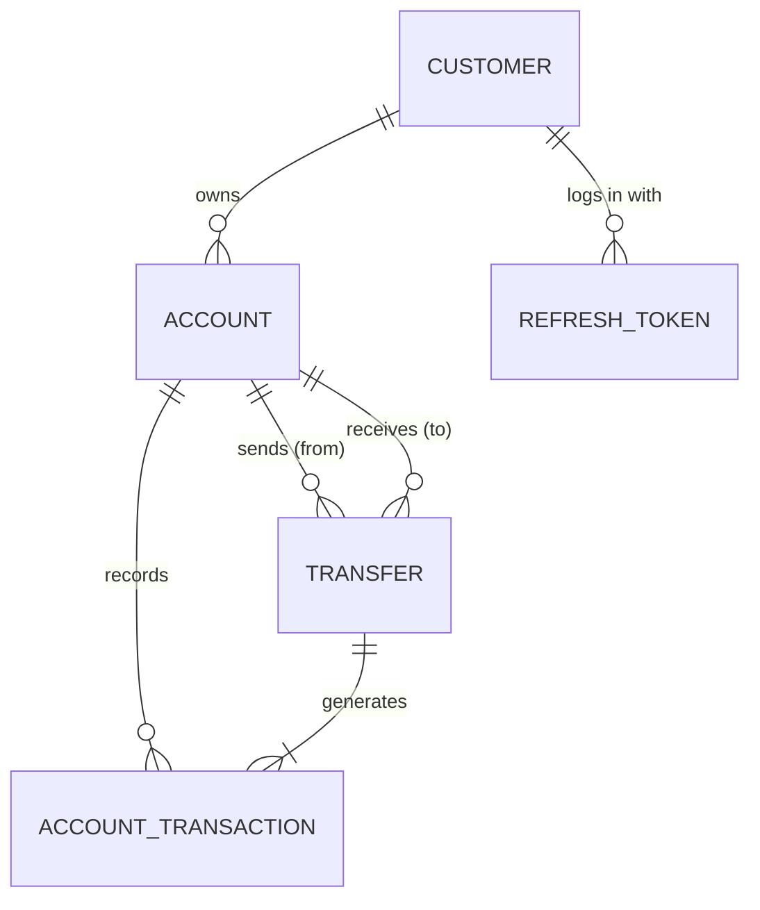
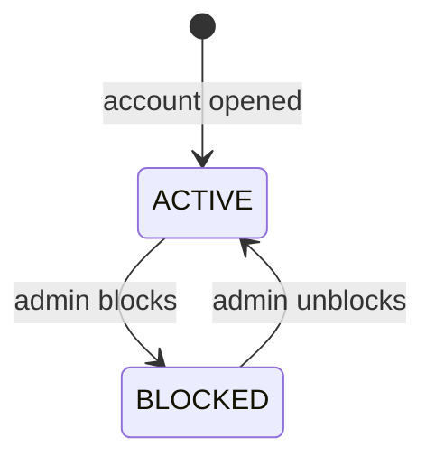

# Bonify — Functional Analysis (MVP)

| | |
|---|---|
| **Document** | Functional analysis |
| **Version** | 0.1 (draft) |
| **Date** | 2026-11-23 |
| **Status** | To be reviewed by the team |

---

## 1. Introduction

### 1.1 Purpose

This document describes **what** the Bonify MVP does: actors, features, business rules, data, API and acceptance criteria. It is the shared reference for the development team and the basis for tests and the final demo. Technical design choices are mentioned only where they affect behaviour.

### 1.2 Product summary

Bonify is a **REST API** for a simplified retail bank. Customers register, open current accounts, deposit and withdraw money, send transfers between accounts and browse their transaction history. An administrator manages customers and can block accounts.

The MVP is backend-only: the user interface is **Swagger UI**, served by the application.

### 1.3 MVP scope

**In scope**

- Customer registration and login (JWT)
- Customer profile: view, update personal data, change password
- Current accounts in EUR: open, view, deposit, withdraw
- Transfers between Bonify accounts, atomic and idempotent
- Paginated transaction history with date filter
- Administration: list and edit customers, block/unblock accounts

**Out of scope**

- Graphical front-end (web or mobile)
- Cards, loans, investments, savings accounts
- Currencies other than EUR, currency conversion
- Transfers to external banks (SEPA), scheduled or recurring transfers
- Notifications (email, SMS, push)
- Account closure, customer deletion, GDPR export
- Microservices, message brokers, Kubernetes

### 1.4 Glossary

| Term | Meaning |
|---|---|
| Customer | A registered person who owns accounts |
| Admin | A back-office operator with extended permissions |
| Account | A current account in EUR, identified by an IBAN |
| IBAN | Account identifier. In the MVP it is generated with a realistic Italian format but is not a real IBAN |
| Deposit | Money added to an account from outside the bank |
| Withdrawal | Money taken out of an account to outside the bank |
| Transfer | Money moved from one Bonify account to another |
| Transaction | One ledger line on an account (deposit, withdrawal, transfer in, transfer out) |
| Idempotency key | A client-generated unique value that makes a repeated transfer request run only once |
| JWT | JSON Web Token, returned at login and sent in the `Authorization: Bearer` header |

---

## 2. Actors and roles

| Actor | Description | How it is identified |
|---|---|---|
| **Guest** | Not logged in | No token |
| **Customer** | Registered user, role `CUSTOMER` | Valid JWT with role `CUSTOMER` |
| **Admin** | Back-office user, role `ADMIN` | Valid JWT with role `ADMIN` |


There is a single admin account, created directly in the database. Admins cannot be created or promoted through the public API, and an admin cannot change other customers' data, password or role (FR-CUS-05).

### 2.1 Permission matrix

| Capability | Guest | Customer | Admin |
|---|:-:|:-:|:-:|
| Register, log in | ✅ | — | — |
| View and update own profile, change own password | — | ✅ | ✅ |
| Open an account | — | ✅ | — |
| View own accounts and their history | — | ✅ | — (owns none, A-02) |
| View any account and its history | — | — | ✅ |
| Deposit, withdraw on own account | — | ✅ | — |
| Send a transfer from own account | — | ✅ | — |
| View a transfer | — | if sender or receiver | ✅ |
| List customers | — | — | ✅ |
| Edit another customer's data, password or role | — | — | — |
| Block or unblock an account | — | — | ✅ |

---

## 3. Functional modules

| Module | Package | Summary |
|---|---|---|
| M1 Authentication | `auth` | Registration, login, JWT issuing and validation |
| M2 Customer profile | `customer` | Profile read and update, password change, admin customer management |
| M3 Accounts | `account` | Open, view, deposit, withdraw, block/unblock |
| M4 Transaction history | `transaction` | Ledger lines, paginated history |
| M5 Transfers | `transfer` | Atomic, idempotent, concurrency-safe transfers |
| M6 Platform | `config`, `exception` | Security config, error handling, API docs |

---

## 4. Functional requirements

Each requirement has an ID used in tests, pull requests and the traceability matrix (section 11).

### M1 — Authentication

**FR-AUTH-01 Register**
- **Actor:** Guest
- **Input:** `firstName`, `lastName`, `email`, `phoneNumber`, `taxCode`, `password`
- **Validation:** all fields required; `firstName` and `lastName` 1–50 characters; `email` valid format, max 254 characters, unique (case-insensitive); `phoneNumber` 7–20 digits, spaces or dashes with an optional leading `+`, max 20 characters; `taxCode` Italian *codice fiscale* format (16 characters, omocodia allowed, case-insensitive), unique; `password` at least 8 characters. Only the format of the tax code is checked, not its check character.
- **Behaviour:** creates a customer with role `CUSTOMER`. The password is stored as a BCrypt hash, never in clear text. Email is stored in lower case, tax code in upper case.
- **Output:** `201 Created` with the customer profile: `id`, `firstName`, `lastName`, `email`, `phoneNumber`, `taxCode` (no password).
- **Errors:** `400` invalid input; `409` email already registered (`EMAIL_ALREADY_USED`) or tax code already registered (`TAX_CODE_ALREADY_USED`).

**FR-AUTH-02 Log in**
- **Actor:** Guest
- **Input:** `email`, `password`
- **Behaviour:** verifies the credentials and issues a JWT. The token subject is the customer **id** (not the email), with the role as a claim. Validity: 5 minutes; the client renews it with the refresh token (FR-AUTH-04).
- **Output:** `200 OK` with `accessToken`, `tokenType: "Bearer"`, `expiresIn` (seconds), `refreshToken`, `refreshExpiresIn` (seconds, 7 days).
- **Session:** one active session per customer. The refresh token is opaque (256 random bits, not a JWT) and only its SHA-256 hash is stored, in the `refresh_tokens` table (entity `refresh_token`, section 6.1). Each login starts a new session (a token *family*) and revokes every previous one, so the previous device can no longer refresh.
- **Errors:** `401` wrong email or password. The message is the same in both cases, so that it does not reveal which emails exist.

**FR-AUTH-03 Protect the API**
- Every endpoint except register, login, refresh, logout and Swagger UI requires a valid token. On register, login, refresh and logout the `Authorization` header is ignored, so an expired access token sent by the client does not cause a `401`.
- Missing, malformed or expired token → `401`. Valid token without the required role or ownership → `403`.

**FR-AUTH-04 Refresh the session**
- **Actor:** Guest (holder of a refresh token)
- **Input:** `refreshToken`
- **Behaviour:** rotation. The presented token is marked as used and swapped for a new access token and a new refresh token in the same family; the new refresh token gets a fresh 7-day validity. Marking the token as used is atomic, so two concurrent refreshes with the same token cannot both succeed: the loser gets `401` without revoking the session (it is most likely the same client, e.g. two tabs). This applies only while the two requests overlap: a request that presents the token after the rotation has been committed is a reuse and revokes the session (FR-AUTH-06).
- **Output:** `200 OK`, same body as FR-AUTH-02.
- **Errors:** `400` missing token; `401` unknown, expired, already used or revoked token (same message in every case). The client must then log in again.

**FR-AUTH-05 Log out**
- **Actor:** Guest (holder of a refresh token)
- **Input:** `refreshToken`
- **Behaviour:** revokes the whole family of the token (the session). Idempotent: an unknown token is ignored. Access tokens already issued stay valid until they expire (stateless API, NFR-02), so the client discards its own. Changing the password (FR-CUS-03) revokes every session of the customer.
- **Output:** `204 No Content`.

**FR-AUTH-06 Refresh token reuse detection**
- A token that was already used (rotated) and is presented again has been copied: either an attacker or the legitimate client is holding an old copy.
- **Behaviour:** the whole family is revoked, so both parties lose the session and the legitimate customer has to log in again. The event is logged as a warning. The check is made before the expiry check, so an old copy is detected even after it has expired, as long as its row still exists.
- **Output:** `401`, same message as any other invalid refresh token.
- **Housekeeping:** a nightly job (03:00) deletes the rows of expired tokens, which can no longer be accepted.

### M2 — Customer profile

**FR-CUS-01 View own profile**
- **Actor:** Customer, Admin
- **Output:** `200 OK` with `id`, `firstName`, `lastName`, `email`, `role`, `createdAt`.

**FR-CUS-02 Update own personal data**
- **Actor:** Customer, Admin
- **Input:** any of `firstName`, `lastName`, `email`, `phoneNumber` (partial update: fields not sent stay unchanged).
- **Validation:** same rules as registration; the new email is stored in lower case and must not belong to another customer (BR-10).
- **Behaviour:** only these four fields can change. `id`, `role`, `password` and `createdAt` are never updated through this operation, even if sent. The current token stays valid after an email change, because its subject is the customer id.
- **Output:** `200 OK` with the updated profile.
- **Errors:** `400` invalid input; `409` email already in use.

**FR-CUS-03 Change own password**
- **Actor:** Customer, Admin
- **Input:** `currentPassword`, `newPassword`
- **Validation:** `currentPassword` must match the stored hash; `newPassword` at least 8 characters and different from the current one (BR-11).
- **Output:** `204 No Content`.
- **Errors:** `400` wrong current password or invalid new password.

**FR-CUS-04 List customers**
- **Actor:** Admin
- **Input:** `page` (default 0), `size` (default 20, max 100)
- **Output:** `200 OK` with a page of customer profiles, sorted by `createdAt` descending: `content`, `page`, `size`, `totalElements`, `totalPages`, `last`.
- **Errors:** `400` `page` negative or `size` outside 1–100.

**FR-CUS-05 No admin edit of other customers**
- Every customer, admin included, edits only their own data (FR-CUS-02, FR-CUS-03, BR-12).
- There is no endpoint to change another customer's data, password or role. The single admin account is created directly in the database.

### M3 — Accounts

**FR-ACC-01 Open an account**
- **Actor:** Customer
- **Input:** none (no request body): every account is in `EUR` in the MVP.
- **Behaviour:** creates an account owned by the caller, with a generated unique IBAN, balance `0.00`, currency `EUR`, status `ACTIVE`.
- **Output:** `201 Created` with the account.

**FR-ACC-02 List own accounts**
- **Actor:** Customer
- **Output:** `200 OK` with all the caller's accounts (IBAN, balance, status, createdAt).

**FR-ACC-03 View an account**
- **Actor:** Account owner, Admin
- **Output:** `200 OK` with the account and its current balance.
- **Errors:** `403` not the owner; `404` IBAN not found.

**FR-ACC-04 Deposit**
- **Actor:** Account owner
- **Input:** `amount`, optional `description` (max 140 characters)
- **Validation:** BR-01 (positive, max 2 decimals); account must be `ACTIVE` (BR-07).
- **Behaviour:** increases the balance and records a `DEPOSIT` transaction with the resulting balance, in one database transaction.
- **Output:** `200 OK` with the updated account.
- **Errors:** `400`, `403`, `404`, `422` account blocked.

**FR-ACC-05 Withdraw**
- **Actor:** Account owner
- **Input:** `amount`, optional `description`
- **Validation:** BR-01, BR-02 (balance cannot go negative), BR-07.
- **Behaviour:** decreases the balance and records a `WITHDRAW` transaction, in one database transaction.
- **Output:** `200 OK` with the updated account.
- **Errors:** `400`, `403`, `404`, `422` insufficient funds or account blocked.

**FR-ACC-06 Block or unblock an account**
- **Actor:** Admin
- **Input:** `status`: `BLOCKED` or `ACTIVE`
- **Behaviour:** changes the account status. A blocked account keeps its balance and history but cannot send or receive money (BR-07).
- **Output:** `200 OK` with the account.
- **Errors:** `400` invalid status; `404`.

### M4 — Transaction history

**FR-TRX-01 View account history**
- **Actor:** Account owner, Admin
- **Input:** `page` (default 0), `size` (default 20, max 100), optional `from` and `to` dates (ISO `YYYY-MM-DD`, inclusive)
- **Output:** `200 OK` with a page of transactions, newest first: `id`, `type`, `amount`, `balanceAfter`, `description`, `transferId` (if any), `createdAt`.
- **Errors:** `400` `from` after `to`, invalid date, `page` negative or `size` outside 1–100; `403`; `404`.

**FR-TRX-02 Ledger integrity**
- Every balance change creates exactly one transaction line, in the same database transaction as the balance update.
- Transaction lines are never updated or deleted through the API.
- For every account: current balance = sum of its transaction lines (deposits and transfers in positive, withdrawals and transfers out negative).

### M5 — Transfers

**FR-TRF-01 Send a transfer**
- **Actor:** Owner of the source account
- **Header:** `Idempotency-Key` (required, UUID)
- **Input:** `fromIban`, `toIban`, `amount`, optional `description` (max 140 characters)
- **Validation:** BR-01, BR-02, BR-06, BR-07, BR-08, BR-09.
- **Behaviour (all or nothing, BR-03):**
  1. Lock both accounts, always in ascending id order, so two opposite transfers cannot deadlock (BR-05).
  2. Check the rules on the locked data.
  3. Debit the source, credit the destination.
  4. Record one `TRANSFER_OUT` line on the source and one `TRANSFER_IN` line on the destination, both linked to the transfer.
  5. Save the transfer with status `COMPLETED` and the idempotency key.
- **Output:** `201 Created` with the transfer.
- **Errors:** `400` invalid input, missing key or same source and destination; `403` not the owner of the source; `404` an IBAN does not exist; `409` key already used with a different body; `422` insufficient funds or an account is blocked.

**FR-TRF-02 Idempotent retry**
- Same `Idempotency-Key` and same body as a completed transfer → `200 OK` with the original transfer. No money moves again and no new lines are created (BR-04).
- Same key, different body → `409 Conflict`.
- Same key sent by another customer, even with the same body → `409 Conflict`: the original transfer is never returned to someone who did not send it.
- A rejected request (4xx) does not consume the key: the client may retry with the same key once the problem is fixed.

**FR-TRF-03 View a transfer**
- **Actor:** Owner of the source or destination account, Admin
- **Output:** `200 OK` with `id`, `fromIban`, `toIban`, `amount`, `description`, `status`, `createdAt`.
- **Errors:** `403`, `404`.

### M6 — Platform

**FR-PLT-01 API documentation** — Swagger UI at `/swagger-ui.html` documents every endpoint, request and response, and lets the user log in with a bearer token.

**FR-PLT-02 Error format** — every error response uses the RFC 7807 `ProblemDetail` format (section 8).

---

## 5. Business rules

| ID | Rule | Violation |
|---|---|---|
| BR-01 | An amount is greater than zero and has at most 2 decimal places | `400` |
| BR-02 | An account balance can never become negative | `422` |
| BR-03 | A transfer is atomic: debit, credit and both ledger lines are saved together, or nothing is | rollback |
| BR-04 | The same idempotency key executes a transfer at most once | `200` with the original; `409` if the body differs |
| BR-05 | Concurrent operations on the same accounts keep balances correct (100 parallel transfers) | concurrency test |
| BR-06 | A customer operates only on their own accounts; an admin can view everything | `403` |
| BR-07 | A blocked account can neither send nor receive money (deposit, withdrawal, transfer) | `422` |
| BR-08 | Source and destination of a transfer must be different accounts | `400` |
| BR-09 | Referenced customers, accounts and transfers must exist | `404` |
| BR-10 | Email is unique across customers, also when it is changed | `409` |
| BR-11 | A password change needs the correct current password; the new one has at least 8 characters | `400` |
| BR-12 | A customer, admin included, edits only their own data: no endpoint edits another customer (FR-CUS-05) | `404` (no such route) |

Money is always handled as `BigDecimal` in code and `NUMERIC(19,2)` in the database, never as floating point.

---

## 6. Data model

English names are used in code and in the database. Mapping to the Italian names in the planning document: `cliente` → `customer`, `conto` → `account`, `bonifico` → `transfer`, `movimento` → `account_transaction`.



### 6.1 Entities

**customer**

| Field | Type | Rules |
|---|---|---|
| id | UUID | primary key |
| first_name | varchar(50) | required |
| last_name | varchar(50) | required |
| email | varchar(254) | required, unique, lower case |
| phone_number | varchar(20) | required |
| tax_code | varchar(16) | required, unique, upper case |
| password | varchar(100) | BCrypt hash, never the clear text |
| role | varchar(20) | `CUSTOMER` or `ADMIN` |
| created_at | timestamptz | set on creation |
| updated_at | timestamptz | set on every update |

**refresh_token** (FR-AUTH-02, 04, 05, 06)

| Field | Type | Rules |
|---|---|---|
| id | UUID | primary key |
| customer_id | FK → customer | required, indexed |
| token_hash | varchar(64) | required, unique; SHA-256 (hex) of the raw token, which is never stored |
| family_id | UUID | required, indexed; the session: shared by all tokens rotated from the same login |
| expires_at | timestamptz | required; 7 days after creation |
| used_at | timestamptz | set when the token is rotated; presenting it again is a reuse (FR-AUTH-06) |
| revoked_at | timestamptz | set on logout, new login, password change or detected reuse |
| created_at | timestamptz | set on creation |

A token is **active** when `used_at` and `revoked_at` are null and `expires_at` is in the future. Each customer has at most one family with an active token.

**account**

| Field | Type | Rules |
|---|---|---|
| id | bigint | primary key; defines the lock order |
| iban | varchar(34) | required, unique |
| customer_id | FK → customer | required |
| balance | numeric(19,2) | `CHECK (balance >= 0)` |
| currency | char(3) | always `EUR` in the MVP |
| status | varchar(20) | `ACTIVE` or `BLOCKED` |
| version | bigint | optimistic lock version |
| created_at | timestamptz | |

**transfer**

| Field | Type | Rules |
|---|---|---|
| id | UUID | primary key |
| from_account_id | FK → account | required |
| to_account_id | FK → account | required, different from source |
| amount | numeric(19,2) | `CHECK (amount > 0)` |
| description | varchar(140) | optional |
| idempotency_key | varchar(64) | required, unique |
| request | varchar(64) | SHA-256 (hex) of the request body, to detect a reused key with a different body |
| status | varchar(20) | `COMPLETED` |
| created_at | timestamptz | |

**account_transaction**

| Field | Type | Rules |
|---|---|---|
| id | bigint | primary key |
| account_id | FK → account | required, indexed with created_at |
| type | varchar(20) | `DEPOSIT`, `WITHDRAW`, `TRANSFER_IN`, `TRANSFER_OUT` |
| amount | numeric(19,2) | always positive; the type gives the sign |
| balance_after | numeric(19,2) | balance right after this line |
| transfer_id | FK → transfer | set only for transfer lines |
| description | varchar(140) | optional |
| created_at | timestamptz | |

### 6.2 Account status



---

## 7. API summary

Base path `/api/v1`: the API version is the first segment after `/api` (`spring.mvc.apiversion`); the paths below omit it for brevity. Bodies are JSON. Amounts are JSON numbers with up to 2 decimals.

| # | Method | Path | Description | Access | FR |
|---|---|---|---|---|---|
| 1 | POST | `/api/auth/register` | Register a customer | Guest | FR-AUTH-01 |
| 2 | POST | `/api/auth/login` | Get an access token and a refresh token | Guest | FR-AUTH-02 |
| 3 | GET | `/api/customers/me` | Own profile | Customer, Admin | FR-CUS-01 |
| 4 | PATCH | `/api/customers/me` | Update own personal data | Customer, Admin | FR-CUS-02 |
| 5 | PUT | `/api/customers/me/password` | Change own password | Customer, Admin | FR-CUS-03 |
| 6 | GET | `/api/customers` | List customers (paged) | Admin | FR-CUS-04 |
| 8 | POST | `/api/accounts` | Open an account | Customer | FR-ACC-01 |
| 9 | GET | `/api/accounts` | Own accounts | Customer | FR-ACC-02 |
| 10 | GET | `/api/accounts/{iban}` | Account detail and balance | Owner, Admin | FR-ACC-03 |
| 11 | POST | `/api/accounts/{iban}/deposit` | Deposit | Owner | FR-ACC-04 |
| 12 | POST | `/api/accounts/{iban}/withdraw` | Withdraw | Owner | FR-ACC-05 |
| 13 | GET | `/api/accounts/{iban}/transactions` | History (paged, date filter) | Owner, Admin | FR-TRX-01 |
| 14 | PATCH | `/api/accounts/{iban}/status` | Block or unblock | Admin | FR-ACC-06 |
| 15 | POST | `/api/transfers` | Send a transfer (`Idempotency-Key` header) | Source owner | FR-TRF-01, 02 |
| 16 | GET | `/api/transfers/{id}` | Transfer detail | Parties, Admin | FR-TRF-03 |
| 17 | POST | `/api/auth/refresh` | Swap a refresh token for a new token pair | Guest | FR-AUTH-04, 06 |
| 18 | POST | `/api/auth/logout` | End the session | Guest | FR-AUTH-05 |


### 7.1 Example: send a transfer

```http
POST /api/transfers
Authorization: Bearer eyJhbGciOi...
Idempotency-Key: 6f1c2a8e-3b4d-4e5f-9a10-1b2c3d4e5f60
Content-Type: application/json

{
  "fromIban": "IT60X0542811101000000000001",
  "toIban": "IT60X0542811101000000000002",
  "amount": 150.00,
  "description": "November rent"
}
```

```http
HTTP/1.1 201 Created

{
  "id": "0b7e6c1a-5d2f-4a8b-9c3e-2f1a0d9e8b7c",
  "fromIban": "IT60X0542811101000000000001",
  "toIban": "IT60X0542811101000000000002",
  "amount": 150.00,
  "description": "November rent",
  "status": "COMPLETED",
  "createdAt": "2026-11-25T10:15:30Z"
}
```

### 7.2 Transfer flow

```mermaid
sequenceDiagram
    actor C as Customer
    participant API as TransferController
    participant S as TransferService
    participant DB as PostgreSQL
    C->>API: POST /api/transfers + Idempotency-Key
    API->>S: transfer(request, key)
    S->>DB: find transfer by idempotency key
    alt key already used
        S-->>API: original transfer (200) or conflict (409)
    else new key
        S->>DB: BEGIN; lock both accounts (ascending id, FOR UPDATE)
        S->>S: check ownership, status, funds
        S->>DB: update balances, insert 2 ledger lines, insert transfer
        S->>DB: COMMIT
        S-->>API: transfer (201)
    end
    API-->>C: response
```

---

## 8. Error handling

All errors use the RFC 7807 `ProblemDetail` format, with an extra `code` field that tests and clients can rely on.

```json
{
  "type": "https://bonify.example/errors/insufficient-funds",
  "title": "Insufficient funds",
  "status": 422,
  "detail": "Account IT60X0542811101000000000001 has 100.00 EUR, 150.00 EUR requested",
  "instance": "/api/transfers",
  "code": "INSUFFICIENT_FUNDS"
}
```

| HTTP | `code` | When |
|---|---|---|
| 400 | `VALIDATION_ERROR` | Invalid or missing fields; the body also carries `errors`, a list of `{ "field", "message" }` |
| 400 | `SAME_ACCOUNT` | Transfer source equals destination |
| 400 | `WRONG_CURRENT_PASSWORD` | Password change with a wrong current password |
| 401 | `UNAUTHORIZED` | Missing, invalid or expired token; wrong credentials |
| 403 | `FORBIDDEN` | Role or ownership check failed |
| 404 | `NOT_FOUND` | Customer, account or transfer does not exist |
| 405 | `METHOD_NOT_ALLOWED` | HTTP method not supported on the path; the `Allow` header lists the supported ones |
| 409 | `EMAIL_ALREADY_USED` | Registration or profile update with a taken email |
| 409 | `TAX_CODE_ALREADY_USED` | Registration with a taken tax code |
| 409 | `IDEMPOTENCY_KEY_REUSED` | Same key, different transfer body |
| 415 | `UNSUPPORTED_MEDIA_TYPE` | Request body with a `Content-Type` other than `application/json` |
| 422 | `INSUFFICIENT_FUNDS` | Withdrawal or transfer above the balance |
| 422 | `ACCOUNT_BLOCKED` | Operation on a blocked account |
| 500 | `INTERNAL_ERROR` | Unexpected error; no stack trace in the response |

---

## 9. Non-functional requirements

| ID | Area | Requirement |
|---|---|---|
| NFR-01 | Security | Passwords hashed with BCrypt; JWT signed with a secret read from the `JWT_SECRET` environment variable; no secrets in the repository |
| NFR-02 | Security | Stateless API (no server session): access tokens are validated without a database lookup and expire after 5 minutes. Only the refresh token (7 days, rotated on every use) is stored server side |
| NFR-03 | Consistency | BR-05 is verified by an automated test: 100 concurrent transfers between the same accounts leave the sum of balances unchanged and no balance negative |
| NFR-04 | Data | Schema generated by Hibernate from the JPA entities (`ddl-auto=update`); no migration tool is used |
| NFR-05 | Quality | Unit tests (Mockito) and web-layer tests (MockMvc) for every module, plus a context test against PostgreSQL; all of them run in CI on every pull request |
| NFR-06 | Delivery | Every pull request to `main` and every push to `main` runs build and tests in GitHub Actions |
| NFR-07 | Portability | PostgreSQL starts locally with `docker compose up -d`; the app runs from the IDE or with Maven. The project is not deployed anywhere, so there is no CD pipeline |
| NFR-08 | Documentation | OpenAPI documentation generated from code; README with architecture, run instructions and CI badge |

---

## 10. Acceptance criteria

```gherkin
Feature: Transfers

  Scenario: Successful transfer
    Given account A has a balance of 500.00 EUR
    And account B has a balance of 0.00 EUR
    When the owner of A sends 150.00 EUR from A to B with a new idempotency key
    Then the response is 201 Created
    And A has a balance of 350.00 EUR
    And B has a balance of 150.00 EUR
    And A has a TRANSFER_OUT line and B has a TRANSFER_IN line for the same transfer

  Scenario: Insufficient funds
    Given account A has a balance of 100.00 EUR
    When the owner of A sends 1000.00 EUR from A to B
    Then the response is 422 with code INSUFFICIENT_FUNDS
    And the balances of A and B are unchanged
    And no ledger line is created

  Scenario: Idempotent retry
    Given a transfer of 150.00 EUR from A to B completed with key K
    When the same request is sent again with key K
    Then the response is 200 OK with the original transfer
    And A was debited only once

  Scenario: Reused key with a different body
    Given a transfer completed with key K
    When a request with key K and a different amount is sent
    Then the response is 409 with code IDEMPOTENCY_KEY_REUSED

  Scenario: Concurrent transfers
    Given accounts A and B each have a balance of 1000.00 EUR
    When 100 transfers of 10.00 EUR run in parallel, 50 from A to B and 50 from B to A
    Then all requests complete without deadlock
    And the sum of the balances of A and B is 2000.00 EUR
    And each account has a ledger whose sum equals its balance

  Scenario: Blocked account
    Given an admin has blocked account B
    When the owner of A sends money to B
    Then the response is 422 with code ACCOUNT_BLOCKED

Feature: Session

  Scenario: Refresh with rotation
    Given a customer logged in and received refresh token R1
    When they send R1 to POST /api/auth/refresh
    Then the response is 200 with a new access token and a new refresh token R2
    And R1 can no longer be used

  Scenario: Expired access token on refresh
    Given a customer whose access token has expired
    When they call POST /api/auth/refresh with a valid refresh token and the expired access token in the Authorization header
    Then the response is 200 with a new token pair

  Scenario: Reuse of a rotated token
    Given refresh token R1 was rotated into R2
    When R1 is sent to POST /api/auth/refresh
    Then the response is 401
    And R2 is revoked too, so the customer has to log in again

  Scenario: Login on another device
    Given a customer is logged in on device A with refresh token R1
    When they log in on device B
    Then R1 is revoked and device A has to log in again once its access token expires

  Scenario: Logout
    Given a customer with refresh token R1
    When they send R1 to POST /api/auth/logout
    Then the response is 204
    And R1 can no longer be used

Feature: Customer profile

  Scenario: Update personal data
    Given a logged-in customer
    When they update their last name and email to a free address
    Then the response is 200 with the new data
    And their current token is still valid

  Scenario: Email already taken
    Given another customer uses "anna@example.com"
    When a customer changes their email to "anna@example.com"
    Then the response is 409 with code EMAIL_ALREADY_USED

  Scenario: Role cannot be changed by the customer
    When a customer sends PATCH /api/customers/me with "role": "ADMIN"
    Then their role is still CUSTOMER

  Scenario: Change password
    Given a logged-in customer
    When they send the correct current password and a new 10-character password
    Then the response is 204
    And they can log in only with the new password
    And their refresh token can no longer be used

  Scenario: Wrong current password
    When a customer sends a wrong current password
    Then the response is 400 with code WRONG_CURRENT_PASSWORD

Feature: Ownership

  Scenario: Access to another customer's account
    Given account A belongs to customer X
    When customer Y requests GET /api/accounts/{iban of A}
    Then the response is 403
```

---

## 11. Traceability matrix

| Requirement | Endpoint # | Main tests |
|---|---|---|
| FR-AUTH-01, 02, 03 | 1, 2 | Registration, login, 401 without token |
| FR-AUTH-04, 05, 06 | 17, 18 | Rotation, expired or revoked token, reuse revokes the session, logout, expired access token ignored on refresh |
| FR-CUS-01, 02, 03 | 3, 4, 5 | Profile update, email conflict, role not changeable, password change |
| FR-CUS-04, 05 | 6 | Admin only (403 for customers); no route edits another customer |
| FR-ACC-01 … 05 | 8–12 | Deposit, withdrawal, insufficient funds, ownership |
| FR-ACC-06 | 14 | Block, then deposit fails with 422 |
| FR-TRX-01, 02 | 13 | Pagination, date filter, ledger sum equals balance |
| FR-TRF-01, 02, 03 | 15, 16 | Success, rejections, idempotency, **100 concurrent transfers** |
| FR-PLT-01, 02 | — | Swagger UI available, error format |

---

## 12. Assumptions and open questions

**Assumptions**

- A-01: Only transfers that complete are persisted. A rejected transfer returns an error, is logged, but is not saved.
- A-02: Admins do not own accounts and cannot move money; they only view, manage customers and block accounts.
- A-03: No daily or per-transfer limits in the MVP, apart from the available balance.
- A-04: All timestamps are stored in UTC.

**Open questions (to decide before development starts)**

- Q-01: Is there a maximum number of accounts per customer?
- Q-02: Should a customer be able to see the name of the receiver before sending a transfer?
- Q-03: Should failed login attempts be limited (for example, 5 attempts then a short lock)?
